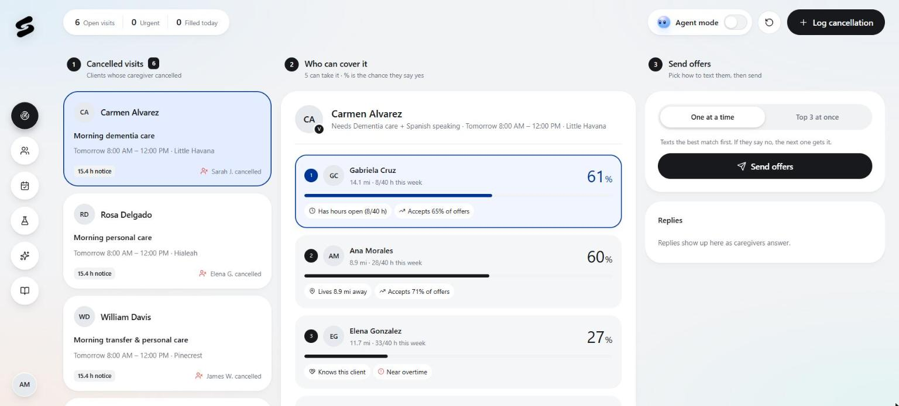
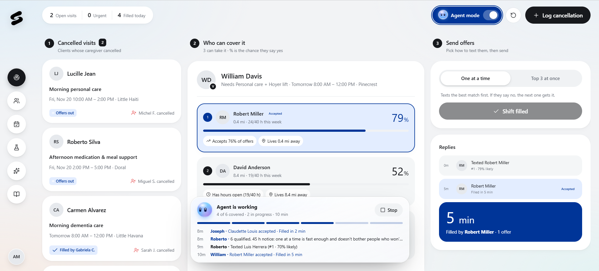
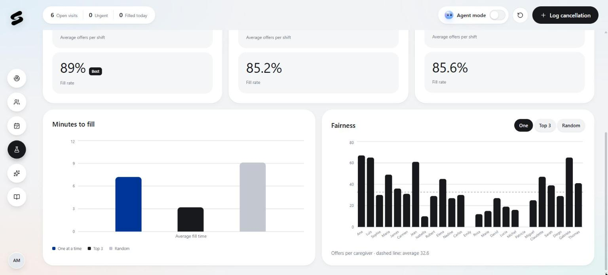
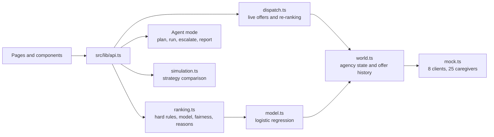

<div align="center">


# Shift Match

**When a home care visit is cancelled, Shift Match finds the caregiver most likely to cover it, texts them in the right order, and re-ranks the list every time someone answers. Or it does the whole thing on its own in Agent mode.**

[**Live demo →**](https://main.d21vib3ih80h72.amplifyapp.com/)




</div>

---

## The problem

A caregiver calls out two hours before a dementia-care visit. Today the coordinator scrolls a spreadsheet, phones whoever lives closest, waits, and phones the next person. It is slow, it ignores most of what actually predicts a "yes", and the same reliable people get called every single time until they burn out.

Shift Match turns that into a ranked, explainable, automatic process.

## What it does

**1 · Cancelled visits.** Every open visit, most urgent first, with who cancelled and how much notice is left. Log a new cancellation from the top bar and it is ranked the moment you save.

**2 · Who can cover it.** Everyone who passes the hard rules, ranked by the model's chance they say yes, with the reasons in plain words ("Lives 2.1 mi away", "Knows this client", "Near overtime"). Anyone filtered out shows the exact rule they failed.

**3 · Send offers.** One at a time (the next best gets it after a decline or silence) or the top 3 at once (first yes wins, the next in line backfills). Replies stream in live, and each decline comes back with a reason that re-weights the ranking for that visit before the next text goes out.

**Agent mode.** Flip the switch and the agent takes over the whole loop: it works through every open visit, most urgent first and up to three at a time, picks the strategy for each one and says why, handles every reply, and escalates only what it cannot cover. When it is done it hands you a report.



## How it decides

### 1. Hard rules (pass all or you're filtered out)

| Rule | Example reason shown |
| --- | --- |
| Available for every hour of the visit (morning / afternoon / evening, per weekday) | `Not available` |
| Not already booked on an overlapping visit | `Booked: George's visit` |
| Has every required skill | `Missing skill: Dementia care` |
| Holds the payer credential | `Missing credential: VA` |
| Stays under their weekly maximum | `Would exceed 40 h this week` |
| Isn't the person who cancelled | `Cancelled this visit` |

### 2. A learned chance of "yes"

A logistic regression trained on six weeks of past offers (about 700 yes/no answers, 80/20 holdout). It sees only what an agency can actually observe:

| Feature | What it captures |
| --- | --- |
| Distance to client | Driving miles from home to the visit |
| Served this client before | Familiar caregivers say yes more, and clients prefer them |
| Weekly hours after the visit | Near-overtime caregivers decline more |
| Notice time (log) | Short notice is harder |
| Weekend | Saturday and Sunday visits |
| Offers in the last 7 days | Fatigue from being asked a lot |
| Past acceptance rate | Their own yes rate, smoothed |
| Time-of-day preference | Do they take mornings, afternoons or evenings more than usual |

The model typically scores an AUC around 0.7 on held-out offers, and the How it works page shows the live weights and metrics. Every answer during a live dispatch is also one online gradient step, so the model keeps learning.

### 3. Cold start and fairness

- **New caregivers** start from their skill group's average acceptance rate (dementia, Hoyer lift or general care) and move toward their own as answers arrive, so they still get offers.
- **Fairness penalty:** people asked more than the team median this week lose a little rank, so the work spreads out.

### 4. Live re-ranking

A decline is information. "Too far" makes distance weigh more *for that visit*, "Time doesn't work" boosts time-of-day fit, "Close to overtime" boosts open hours. The list re-ranks before the next text, and the timeline says why ("Distance weighs more now · Maria moves up to #2").

## Agent mode

| Situation | What the agent does |
| --- | --- |
| Under 12 h of notice and more than one qualified | Texts the top 3 at once, because waiting on one at a time is too slow |
| 12 h or more of notice | One at a time, so people who won't be needed aren't bothered |
| Nobody passes the rules, or everyone declines | Stops and escalates with the reason (it never guesses) |
| A caregiver already has an offer out for another visit | Skips them until they answer, so nobody gets two texts or two bookings |
| A cancellation is logged while it's on | Picks it up automatically |

The report shows visits covered, time from start to last reply, texts sent, the visits that need a person (with a jump back to Dispatch), every visit with the strategy and why, whose hours changed, and how evenly offers were spread.

## Results

The Simulation page replays the same random cancellations against the same simulated caregivers under each strategy, so the only difference is the strategy. A visit only counts as filled if someone says yes within half the notice time (max 2 hours). One 500-shift run:

| Strategy | Avg minutes to fill | Avg texts per shift | Fill rate |
| --- | --- | --- | --- |
| **Shift Match, one at a time** | 7.2 | **1.63** | **89.0%** |
| **Shift Match, top 3** | **3.2** | 3.12 | 85.2% |
| Random qualified pick | 9.1 | 2.03 | 85.6% |

Ranked one-at-a-time fills more shifts with about 20% fewer texts than a random pick. Top 3 is the fastest when every minute counts, which is exactly when Agent mode uses it.



## Under the hood



`src/lib/api.ts` is the only module the UI imports. Replacing the in-memory engine with a real backend means re-implementing those functions with `fetch` and keeping the same signatures.

```
src/
  lib/
    api.ts            data, live dispatch and agent mode, the UI's only entry point
    types.ts          shared types
    mock.ts           seed data: real Miami neighborhoods, skills, credentials, availability
    engine/
      world.ts        agency state, six weeks of generated offer history, hard rules
      features.ts     what the model can observe about an offer
      model.ts        logistic regression: training, prediction, online updates, AUC
      ranking.ts      rules → likelihood → fairness → plain-English reasons
      dispatch.ts     live offer loop that learns from replies and re-ranks
      simulation.ts   paired Monte Carlo comparison of strategies
      truth.ts        how the simulated caregivers actually behave (hidden from the model)
  features/           Dispatch, Caregivers, Shifts, Simulation, Agent report, How it works
  components/         app shell, agent dock and buddy, custom dropdown and date picker
  test/               engine and routing tests
```

### Tech stack

React 19 · TypeScript (strict) · Vite 8 · TanStack Router and Query · Tailwind CSS 4 · Radix primitives · Recharts · Vitest · AWS Amplify Hosting

## Getting started

Requires Node 20.19 or newer.

```sh
npm install
npm run dev        # http://localhost:5173
npm test           # 20 tests: rules, ranking, live offers, agent mode, simulation, routing
npm run build      # type-check and build the static site into dist/
```

## Testing

The engine tests check behavior, not implementation details:

- every filtered-out reason is actually true for that caregiver
- rankings are ordered, scored between 0 and 1, and always explained
- the model learned sensible directions (distance down, client history up, near-overtime down)
- one at a time never has two offers out, and top 3 withdraws the rest on a fill
- filling a shift books the caregiver and adds their hours
- the agent handles every visit, explains each strategy, never double-books anyone, and picks up new cancellations
- the simulation's totals add up

Tests run with a pinned clock and no delays, so they are deterministic and fast.

## Deployment

Hosted on AWS Amplify as a static site. `amplify.yml` installs Node 22, runs `npm ci`, the tests and the build, and publishes `dist/`. Every merge to `main` redeploys. A single rewrite rule sends every non-file path to `index.html` so links like `/agent` work on refresh.

## Honest about the prototype

- There is no backend: the agency lives in memory in the browser and resets on reload.
- Caregiver replies are simulated from a hidden temperament per person. The model never sees it; it only learns from the yes, no or silence that comes back, like it would with real people.
- No real texts are sent.

## What's next

- Real SMS offers and replies (two-way texting with quick-reply decline reasons)
- A backend with persistent offer history so the model trains on real answers
- Pull schedules and credentials from the agency's EVV or scheduling system
- Let coordinators approve or edit the agent's plan before it texts anyone

---

<div align="center">

Built by **Ulises Cheong** · [github.com/ulicomp](https://github.com/ulicomp)

</div>
